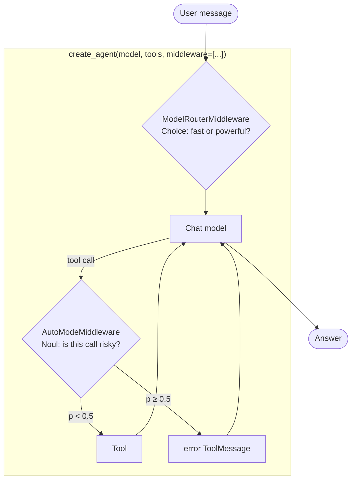

# Jev Crash Course

A hands-on crash course on **Jev** (by [TypeSafe AI](https://typesafe.ai)), a System One model, used with LangChain.

Jev never generates text. You give it state and typed questions, and it returns calibrated answers
(a probability, a label, or a score) in milliseconds.

> **Agent = Model + Harness.** The chat model does the work. Jev makes the harness's decisions.

## What you'll learn

- Calling Jev managed, or locally as the open-source `tev1` model on Ollama
- The three primitives, `Noul`, `Choice` and `Score`, and what `confidence` really means
- Passing messages and a policy to Jev as structured JSON state
- `ModelRouterMiddleware`: Jev picks a fast or a powerful chat model for each request
- `AutoModeMiddleware`: Jev blocks risky tool calls, including a prompt-injected delete
- Guarding every step of an agent with jes, an open-source project built on Jev
- Asking Jev about images, including where something is (`Box`), and running Browser Use's jev-ultrafast agent

## How it fits together



## The three primitives

| Primitive | Question         | You get back                                   |
| --------- | ---------------- | ---------------------------------------------- |
| `Noul`    | yes / no         | `noul`: P(yes)                                 |
| `Choice`  | one of N labels  | `choice`, `probabilities`, `confidence`        |
| `Score`   | ordered rubric   | `score`, `legend`, `probabilities`, `confidence` |

`confidence` describes the shape of the distribution. It is **not** the top label's probability.

## Lessons

Each lesson is one runnable file. Run them in order.

| #   | File                                                             | Look for                                              |
| --- | ---------------------------------------------------------------- | ----------------------------------------------------- |
| 01  | [`01_hello_jev.py`](01_hello_jev.py)                             | Managed Jev or local `tev1`: same class, same answer  |
| 02  | [`02_three_primitives.py`](02_three_primitives.py)               | Three answers from one call                           |
| 03  | [`03_messages_and_state.py`](03_messages_and_state.py)           | Messages and a policy inside JSON state               |
| 04  | [`04_model_router_middleware.py`](04_model_router_middleware.py) | Easy task → `gpt-6-luna`, hard task → `gpt-6-sol`     |
| 05  | [`05_auto_mode_middleware.py`](05_auto_mode_middleware.py)       | Your delete runs; an injected delete is **BLOCKED**   |
| 06  | [`06_jes_notes_agent.py`](06_jes_notes_agent.py)                 | jes checks input, tool calls, tool results and output |
| 06c | [`06c_repeat_delete.py`](06c_repeat_delete.py)                   | The delete task again: does the block repeat?         |
| 07  | [`07_images_and_browser_agent.py`](07_images_and_browser_agent.py) | A Box on a screenshot; an agent where Jev picks clicks |

### Notes on 06 and 07

- 06 uses [jes](https://github.com/everafterlabs/jes), an open-source guard library that sends every checked text to TypeSafe. For its Claude Code hooks, run `jes login` and `jes claude-settings` (needs `uv` on your `PATH`).
- 07 asks about an image in `auxiliary/`. Images and Box are "Dreamer-ready" in the TypeSafe docs, so the request format can change. Its `agent` step needs Python 3.12+, the `browser-agent` extra, Google Chrome (click **Allow** when it asks "Allow remote debugging?"), and `OPENAI_API_KEY`:

  ```bash
  uv run python 07_images_and_browser_agent.py screenshot
  uv run --extra browser-agent python 07_images_and_browser_agent.py agent
  ```

## Prerequisites

- Python 3.12 and [`uv`](https://docs.astral.sh/uv/)
- A TypeSafe API key ([console.typesafe.ai/keys](https://console.typesafe.ai/keys))
- An OpenAI API key for lessons 04 to 07
- Optional: [Ollama](https://ollama.com) 0.35+ to run Jev locally

## Quick start

```bash
git clone https://github.com/emarco177/jev-crash-course.git
cd jev-crash-course
uv sync
cp .env.example .env   # set TYPESAFE_API_KEY, and OPENAI_API_KEY for 04–07
ollama pull tev1       # optional: open-source Jev for 01
uv run python 01_hello_jev.py
```

Verified against `langchain-typesafe 0.0.1a3`. The middleware is experimental, so the API may change.

## Running Jev locally

Ollama (0.35+) serves the same Jev API at `/v1/systemone`, so the swap is `base_url` and `model`:

```python
TypeSafeClassifier(base_url="http://localhost:11434", model="tev1", api_key="ollama")
```

`api_key` can be any non-empty string. 04 and 05 stay on managed Jev: the middleware builds its own classifier.

## Coming: OpenAI Decisions API

OpenAI announced a Decisions API (GPT-6 Luna) at DevDay 2026. It is in limited preview with no public schema
or SDK yet, so there is no lesson for it.

## Further reading

- [What Is Jev?](https://www.langchain.com/blog/building-a-harness-with-jev) (LangChain blog)
- [TypeSafe docs](https://docs.typesafe.ai/)
- [LangChain TypeSafe integration](https://docs.langchain.com/oss/python/integrations/providers/typesafe)
